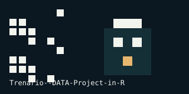

# Trenario: choice, satisfaction, and course outcomes

An applied econometrics project studying whether letting learners choose a virtual instructor changes their satisfaction and course performance. The analysis was prepared for Trenario with survey and course observations, then explored in R.

**[Open the project showcase](https://eforus-overseer.github.io/Trenario--DATA-Project-in-R/)** · **[Browse the source](https://github.com/eforus-overseer/Trenario--DATA-Project-in-R)**

## Research question

Does giving a learner a choice of virtual instructor affect how satisfied they feel and how well they perform in the course?

The study compares a control path (group A, no instructor choice) with a treatment path (group B, instructor choice). It considers repeated cross sections across two periods and uses difference-in-differences, OLS, linear probability, and logistic models.

## What the analysis found

The original report describes two related results:

- The difference-in-differences specification did not provide a statistically clear treatment effect over time.
- The choice group was generally more satisfied, and satisfaction moved with the learner's positive sentiment toward the instructor. These patterns are useful signals, but the sample and observational design limit causal claims.

## Repository layout

```text
data/raw/      Source CSV and Excel files used by the analysis
analysis/      R script with feature engineering and model specifications
figures/       Published charts, screenshots, and the correlation matrix
reports/       Final report PDF and editable project archive
docs/          GitHub Pages showcase
assets/        Pixel-art repository signature
```

## Reproduce the analysis

1. Open the repository root in R or RStudio.
2. Install the packages listed at the top of [`analysis/trenario_analysis.R`](analysis/trenario_analysis.R).
3. Run the script from the repository root. The script reads [`data/raw/Pdata.csv`](data/raw/Pdata.csv) with a repository-relative path.

The checked-in figures are the original project outputs. The raw files are retained for auditability; inspect their schemas and provenance before using them for new work.

## Outputs

- [`reports/Final Report-Group 5 TP.pdf`](reports/Final%20Report-Group%205%20TP.pdf) — written report
- [`reports/Group 5 Trenario Project.docx.zip`](reports/Group%205%20Trenario%20Project.docx.zip) — editable report archive
- [`figures/graph3.jpg`](figures/graph3.jpg) — satisfaction and instructor sentiment
- [`figures/CorrMatrixCluster.jpg`](figures/CorrMatrixCluster.jpg) — correlation matrix

The repository and showcase were reorganized to keep the analysis readable and to make the project easy to explore without exposing personal contact details.


